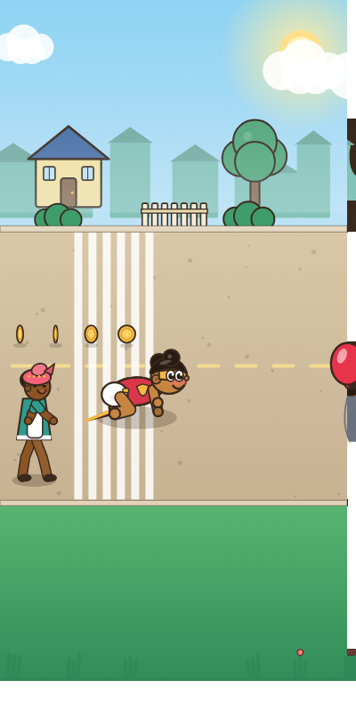
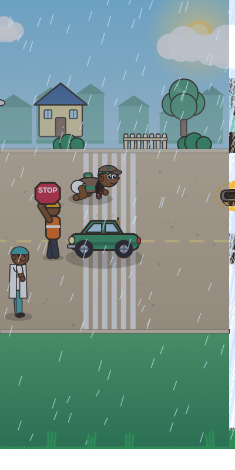
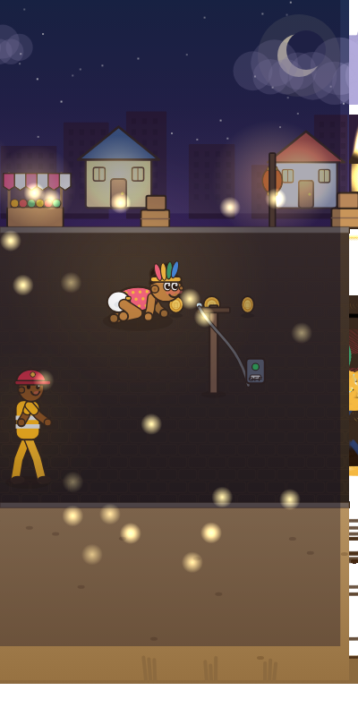
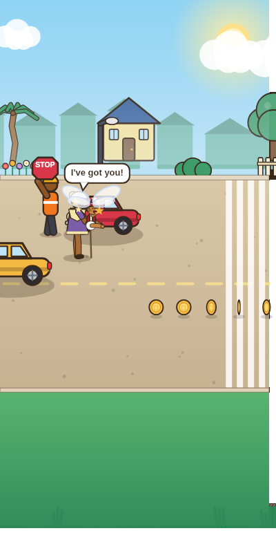

# APUTU: Baby's Day Out

A warm, family-friendly browser game built with **TypeScript + Vite + Canvas**.
Aputu, a fearless toddler, crawls out of the front door and down a lively African
neighbourhood. You can't steer him — you're his invisible guardian, clearing every
hazard from his path before he gets there.

No backend, no image files, no audio files: every character, prop and sound is drawn or
synthesised at runtime, so the whole game is **~49 KB gzipped**.



| Storm event | Night Market | The rescue |
|---|---|---|
|  |  |  |

## Quick start

```bash
npm install
npm run dev          # http://localhost:5173
```

| Command | What it does |
|---|---|
| `npm run build` | type-check, then build to `dist/` |
| `npm run preview` | serve the production build |
| `npm test` | 96 tests (logic, rendering, and a headless full-game simulation) |
| `npm run check` | typecheck + data validation + tests |
| `npm run validate` | sanity-check `src/data/*` (ids, references, coverage) |
| `npm run preview:art` | render sprite/scene contact sheets to `docs/previews/` |
| `npm run preview:screens` | capture real in-game screenshots to `docs/previews/` |

## What makes it feel alive

**Aputu is a character, not a dot.** He crawls with a real hands-and-knees gait that matches
his speed, tilts his head when puzzled, sniffs flowers (and sneezes), chases butterflies,
reaches for balloons, pets friendly cats, yawns, waves, claps, and now and then turns round to
grin at his guardian. When he's upset he cries; when he's rescued he giggles. His curiosity is
also what makes hazards matter: he always crawls toward the next one.

**13 guardians who are people.** Nanny, Grandma, Grandpa, Dad, Mom, Big Sister, Robot Nanny,
Super Nanny, Village Chief, Teacher, Doctor, Police Officer and Firefighter chase him down the
street, shout encouragement, look worried when something's close, and make a warm, cartoon
rescue (halo, orbiting stars, a cuddle) when a hazard gets through. Each has a perk that is
genuinely implemented — a test guards against advertised perks that aren't wired up.

**A world that reacts.** 15 neighbourhoods with their own skyline, buildings, roadside props,
road surface and surroundings (a river under a plank bridge, bunting at the festival, lanterns
at the night market). Weather (rain, thunderstorms with lightning, wind, dust, fireflies,
confetti), a real night mode where Aputu carries his own pool of light, and **challenge
events** — traffic jams, runaway goats, heavy rain, power cuts, parades, a broken traffic
light, and a lucky "golden hour".

**Hazards that do things.** Cars, buses and okadas roll toward him with spinning wheels; dogs
sleep (Zzz); goats glare; wires spark. Fixing one has a visible, charming outcome — a crossing
guard steps out with a STOP sign, a plank bridges the gutter, a carrot calms the goat, a mat
covers the puddle.

**Modes:** Endless · Zen (a cuddle instead of game over) · Time Attack (90 s) · Hardcore (no free saves).

**Progression:** player levels with titles, stars per run, per-mode high scores, daily missions
with streaks, 16 achievements, a coin shop (14 outfits, 13 guardians) and **Nanny's Scrapbook** —
31 memories (every hazard, every neighbourhood, every curious moment) with funny captions and
little illustrations, unlocked as you meet them.

**Story:** a short animated intro explains how Aputu ended up outside, and teaches the controls.

**Accessibility:** colour-blind-friendly mode, reduce-motion, optional hints, a no-fail Zen mode.

## Controls

- **Tap** — stop traffic, shoo dogs and chickens, redirect barrels
- **Drag** — pull carts and cones out of the way, slide a plank over a gutter
- **Hold** — calm a goat with a carrot, switch off a sparking wire

Watch the **ring** around each hazard: it tightens and reddens as Aputu closes in.

## Project layout

```
APUTU/
├── public/        static files served as-is (favicon, manifest, robots)
├── src/
│   ├── main.ts            entry point
│   ├── types.ts           shared interfaces
│   ├── utils.ts           math, colour (shade/mix), seeded random, easing
│   ├── data/              pure content, no logic — add content here
│   │   worlds · hazards (core/) · nannies · powerups · outfits · missions
│   │   modes · events · scrapbook · levels
│   ├── core/              game logic
│   │   game.ts (engine) · baby.ts (behaviour) · hazards.ts · powerup-system.ts
│   │   events.ts · storage.ts · audio.ts · particles.ts
│   ├── render/            all art, as code
│   │   baby.ts · guardian.ts · hazards.ts · scenery.ts · weather.ts · overlay.ts · draw.ts
│   ├── ui/                ui.ts (screens/HUD) · stage.ts (animated menu canvases + intro)
│   └── styles/            style.css · screens.css · polish.css
├── assets/        source art/audio staging area (currently empty by design)
├── docs/          ARCHITECTURE · DESIGN · DEPLOYMENT · CHANGELOG · previews/
├── scripts/       validate-data.mjs · preview-art.ts
├── tests/         unit, render-smoke and full-game simulation tests
└── index.html · package.json · vite.config.ts · tsconfig.json · netlify.toml
```

See `docs/ARCHITECTURE.md` for how the pieces fit, and `docs/DEPLOYMENT.md` for Netlify
(build command `npm run build`, publish directory `dist`).

## Adding content

Almost everything is data. A new **world** = one entry in `data/worlds.ts` + one line in
`SCENES` (`render/scenery.ts`). A new **hazard** = an entry in `core/hazards.ts` + a drawing
function in `render/hazards.ts` + a scrapbook caption. `npm run validate` and `npm test` will
tell you if you forgot a piece.
